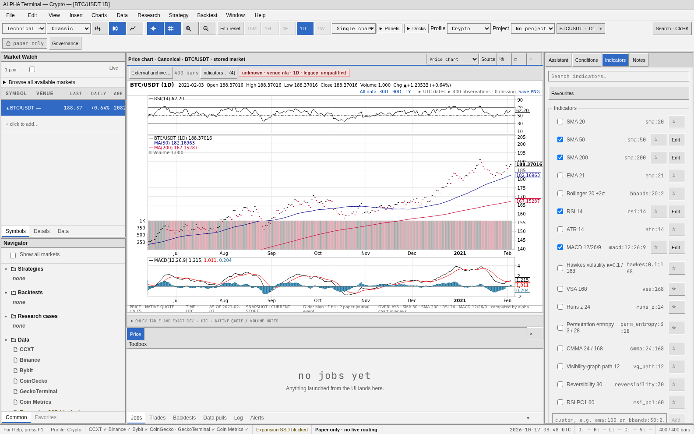
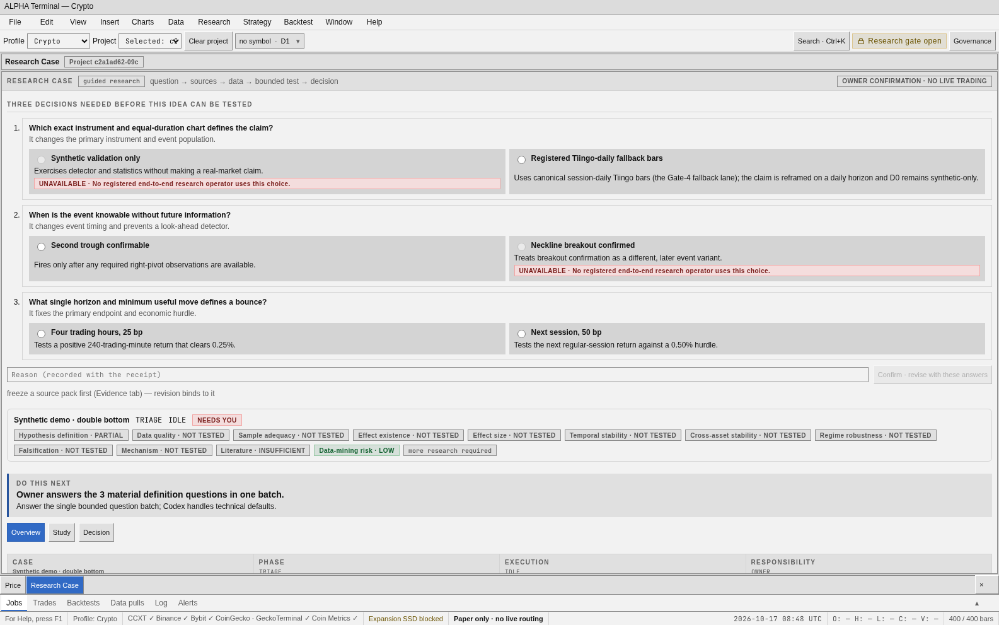
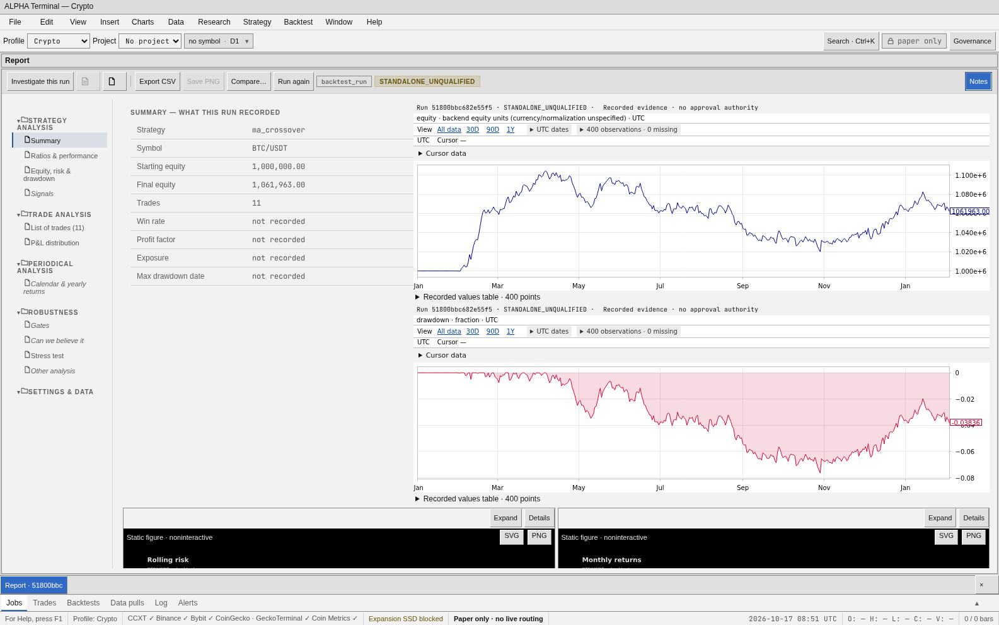
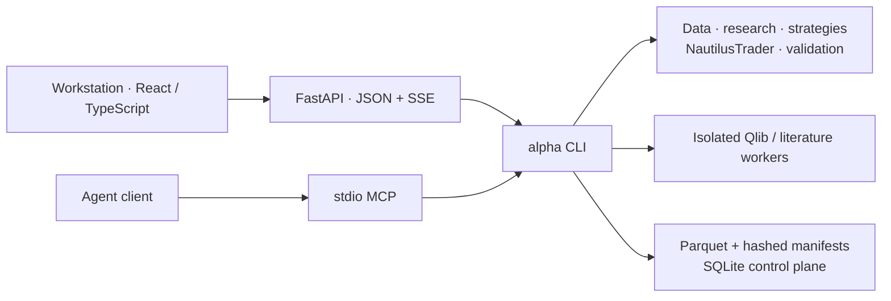

# Project ALPHA

**ALPHA Quant Platform** is a private, local quantitative research workstation for turning a
market idea into a reproducible test and an auditable decision. It brings point-in-time data,
event-driven backtests, statistical validation, model experiments, and research records into one
terminal, backed by the same Python CLI used by agents and automation.

The goal is to assess whether an apparent edge survives costs, out-of-sample testing, and competing
explanations. A chart, a model answer, or a profitable backtest alone does not establish an edge.



*Chart exploration in the implemented Workstation. All screenshots below were captured from a
fresh build at [fbdcbcf](https://github.com/tradingsystem1880-eng/Project-ALPHA/commit/fbdcbcfdf29aebe3fd43e38bf5ae4051cbf23b98), using the isolated real backend and synthetic test data. They show the
product UI, not live market performance or an owner's account.*

## A plain-English guide

Think of ALPHA as a research notebook with a testing laboratory attached. You bring a market
question; it helps you organize the data, run a repeatable experiment, and inspect the evidence.
It does not decide that an idea is safe to trade. A good-looking chart or a passing software test
is not proof of a profitable strategy.

The parts work together like this:

- **The Workstation is the front desk.** Its charts, Research Cases, and reports help you explore
  questions and inspect recorded results. Start with the [research workflow](#research-workflow)
  and [Quickstart](#quickstart).
- **The CLI is the coordinator.** The browser and agent tools ask it to perform supported actions.
  It connects data, simulations, validation, and research records while keeping explicit owner
  decisions separate from suggestions. See the [project map](docs/context/alpha-quant-platform.md).
- **The research packages are the laboratory.** They keep data tied to what was known at the
  time, simulate strategies with costs, and test competing explanations. Saved snapshots and
  receipts let you check which inputs produced a result. See the [architecture](docs/ARCHITECTURE.md).
- **Workers are separate specialist rooms.** Qlib model experiments and literature tools run in
  their own environments. Their results still need qualification; an installed worker is not
  approval to use a model. See the [Qlib guide](workers/qlib/README.md).
- **Codex helps explain and investigate.** Its answers are advisory. Atlas helps find source-bound
  project context; neither generated prose nor a context query grants research authority. See the
  [context index](docs/context/README.md).
- **The Software Team maintains the machinery.** It changes code, checks the result, and records
  what was delivered. Those engineering checks are separate from approval of market evidence or
  paper operations. See the [Software Team map](docs/context/software-team.md).

A useful first session is to start the Workstation, capture a Research Case, and inspect what is
missing before running an experiment. An empty installation has no acquired market data or
research results. Follow the [operations runbook](docs/operations/README.md) for deliberate data
setup; do not put credentials in Git or browser state.

Charts, backtests, governed research records, validation tools, and bounded model experiments are
implemented. Full counterfactual ML fold retraining and autonomous RD-Agent research remain
unfinished or deferred. Paper paths require separate opt-ins and readiness evidence; **no
live-capital route ships**. The [scope and limits](#implemented-scope-and-limits) and
[authority matrix](docs/governance/capability-authority-matrix.md) explain these boundaries.

## Research workflow

1. **Define the question.** Capture an idea as a Research Case; resolve the instrument, event
   timing, outcome, alternative explanations, and falsification criteria before strategy development.
2. **Fix the data and protocol.** Inspect provider provenance, qualify inputs, and freeze exact
   snapshot membership. Point-in-time reads respect when observations became available; venues,
   quote currencies, native intervals, and dataset families remain explicit.
3. **Explore, then confirm.** The governed lifecycle separates a synthetic D0 pilot, registered
   D1 discovery, and owner-approved one-shot D2 confirmation. Execution depends on a compatible
   registered operator and admitted data; D3 stays unavailable to research. Promotion requires
   verified evidence and an owner decision.
4. **Build and test.** Use rule strategies, the Strategy Builder, scans, and the Development Center.
   Canonical simulations use NautilusTrader, with decisions at close `t` and fills at open `t+1`.
   Standalone sandbox experiments remain unqualified for governed research.
5. **Evaluate and retain evidence.** Inspect recorded trades, equity, drawdown, costs, and validation.
   The gauntlet includes walk-forward testing, randomized nulls, bootstrap intervals, deflated
   Sharpe, and combinatorial cross-validation; parameter searches add overfitting controls.
   Four-family Monte Carlo measures path risk separately from proof of edge.



*Research Case: the real capture workflow exposes unanswered questions and blocked steps before
compute. This demo case has no approved research contract or empirical finding.*

The Workstation also provides linked technical charts and exact data tables/CSV exports, run
comparison, provider and job monitoring, Kronos forecast diagnostics, and an isolated Qlib ML lab.
Its bounded Codex assistant and recorded-run investigations can explain attached evidence and
suggest tests; their output is advisory. Numerical research results come from executed code and
verified artifacts, not generated prose. Codex inference uses the configured remote service.



*Recorded results from an actual synthetic-data backtest. The standalone-unqualified label is
retained; these numbers are a UI demonstration and carry no market-performance claim.*

See the [Quant Platform map](docs/context/alpha-quant-platform.md),
[bounded research workflow](docs/operations/bounded-research-workflow.md),
[research contracts](docs/operations/research-platform-contracts.md), and
[Monte Carlo guide](docs/operations/monte-carlo/README.md) for the detailed protocols.

## Architecture and infrastructure

ALPHA runs on a single local machine. Python 3.12 packages form a locked `uv` workspace with
enforced import boundaries; the CLI is the sole engine and validation composition layer.



| Layer | Responsibility |
| --- | --- |
| Research engine | Point-in-time data access, causal signals, costed simulation, statistical tests, and deterministic artifacts. |
| CLI and control plane | Compose runs; govern projects, contracts, jobs, evidence, and owner decisions. SQLite owns mutable control state. |
| Storage | Immutable snapshots, receipts, manifests, typed Parquet, and HTML audit reports; public crypto bulk data may use a separately configured volume. Paper journals stay outside research run identity. |
| Web and MCP | Relay supported CLI operations and read bounded projections. Neither surface runs the engine in-process. The browser renders recorded Python results. |
| Worker environments | Separately locked processes exchange validated JSON/Parquet. Qlib models and executable objects do not cross into the root environment. |

The production SPA is committed inside the Python web package, so running the installed
Workstation does not require Node. Provider acquisition is explicit; configuration, verification,
data qualification, research admission, and paper readiness are distinct states.

See the [architecture](docs/ARCHITECTURE.md), [decisions](docs/adr/README.md), and
[capability and authority matrix](docs/governance/capability-authority-matrix.md).

## Quickstart

Requires Python 3.12 and [`uv`](https://docs.astral.sh/uv/). From the repository root:

```bash
uv sync --locked
uv run alpha info
uv run alpha-web
```

Open **http://localhost:8801**. The Workstation binds to loopback for private, single-owner use;
local confirmation is a trusted-local boundary, not multi-user authentication. A new store has
no market data or research results. Use the [data and operations runbook](docs/operations/README.md)
to configure providers and deliberately acquire data; credentials stay outside browser state and Git.

Explore the CLI or capture a question without launching research compute:

```bash
uv run alpha research capture "Does a confirmed double bottom predict a bounce after costs?" --json
uv run alpha research --help
uv run alpha backtest --help
uv run alpha validate --help
uv run alpha info commands --all --json
```

For an MCP-capable client, launch `uv run alpha-mcp` with this repository as its working directory.
The CLI, Workstation, and MCP share the configured data store and authority rules.

<details>
<summary>Linux cloud development setup</summary>

With `uv`, Python 3.12, Node/npm, GNU `timeout`, and Chromium system libraries already available,
run `bash scripts/cloud_setup.sh`. It installs locked root/frontend dependencies and pinned
Chromium, then runs CLI and browser-runtime smokes. It does not replace app E2E tests and the full
gate. With `ALPHA_CLOUD_FOUNDATION=1` it also installs the Git guards, appends the two worker-venv
excludes, regenerates the verified fontconfig below into `.alpha/state/runtime/fontconfig/` and
reports (never fetches) `origin/main`. Adding `ALPHA_RDAGENT_PRISTINE` and `ALPHA_RDAGENT_SOURCE`
verifies the pinned checkout, builds the derived root and qualified worker venvs only when absent,
and validates existing ones against their recorded rule profile. Each step fails loud; none claims readiness.
A venv build writes `.alpha/state/runtime/rdagent-venv-<profile>.incomplete` first and renames it to
`.built-<UTC>` only after the new environment validates. If that marker remains, a re-run keeps a venv
that now validates in place and otherwise refuses, preserving the partial venv. Only then, and only for
a marker in exactly the script's own one-line format, `ALPHA_RDAGENT_RETIRE_INTERRUPTED=1` moves the
venv and marker unchanged to `.alpha/state/runtime/interrupted/<profile>-<UTC>/` (kept as evidence, not
runnable because its paths name the original location) and builds afresh. Unmarked environments are
never moved, and nothing is deleted.

Persist these environment-level settings separately so later shells inherit them:

```text
UV_CACHE_DIR=/tmp/project-alpha-uv-cache
UV_TOOL_DIR=/tmp/project-alpha-uv-tools
UV_LINK_MODE=copy
XDG_CONFIG_HOME=/tmp/project-alpha-xdg
npm_config_cache=/tmp/project-alpha-npm-cache
PLAYWRIGHT_BROWSERS_PATH=/tmp/project-alpha-playwright-browsers
SEMGREP_VERSION_CACHE_PATH=/tmp/project-alpha-semgrep/semgrep_version
```

The setup script respects configured paths and creates the Semgrep file's parent directory.
Web ML subprocesses preserve the configured `UV_CACHE_DIR` through the existing isolated-worker
environment, so installed-worker capability checks use the same writable cache as CLI checks.
If temporary assets are not retained, rerun setup synchronously before browser work. Download or
host-library failures require correcting the environment before claiming readiness.

Some cloud images add `/etc/fonts/conf.d/56-prefer-inter.conf` (owned by no package; observed
SHA-256 `1e74ca86…5a9e`), which aliases `-apple-system`, `Segoe UI`, `system-ui` and `sans-serif`
to system Inter. Chromium then renders the chrome stack with that system font, while Linux visual
baselines record the app's self-hosted `Inter Variable` webfont. Run browser checks with a derived
fontconfig that omits only that rule; leave `/etc` and every other rule unchanged:

```sh
if [ -e /etc/fonts/conf.d/56-prefer-inter.conf ]; then
  cfg="$(mktemp -d /tmp/project-alpha-fontconfig.XXXXXX)" && mkdir "$cfg/conf.d"
  for f in /etc/fonts/conf.d/*; do
    [ "${f##*/}" = 56-prefer-inter.conf ] || ln -s "$(readlink -f "$f")" "$cfg/conf.d/${f##*/}"
  done
  sed "s#<include ignore_missing=\"yes\">conf.d</include>#<include ignore_missing=\"yes\">$cfg/conf.d</include>#" \
    /etc/fonts/fonts.conf > "$cfg/fonts.conf"
  export FONTCONFIG_FILE="$cfg/fonts.conf"
fi
```

Verified 2026-10-27 with fontconfig 2.15.0, Playwright 1.61.1 and Chromium 149.0.7827.55: the
derived `fonts.conf` differs from the system file (`93a23ba0…ca22`) only in that include line, and
the 40 linked rules (name plus target SHA-256, sorted) hash to `8e3428b1…22f9`. Without the image
rule, use the system configuration unchanged.

</details>

## Implemented scope and limits

- **Models:** Kronos diagnostics and a separately locked Qlib worker are implemented, including
  fold-local Alpha158-style features, LightGBM, a rank ensemble, and synchronized costed ALPHA
  replay. Full counterfactual fold retraining and single-asset ML equivalence are not implemented;
  the replay is not a full ML gauntlet or promotion evidence. RD-Agent autonomous research is
  deferred. See the [Qlib worker](workers/qlib/README.md) and
  [external capability boundary](docs/adr/0035-generic-study-composition-and-external-capability-adapters.md).
- **Paper operations:** Binance public data feeds a local Nautilus sandbox; stock/ETF intents
  have a separately gated IBKR Paper path. Both are opt-in. Provider/network acceptance, current
  data qualification, and paper readiness require their own receipts. No live-capital route ships.
- **Data:** Tiingo is the canonical stock/ETF EOD path after qualification. Crypto authority is
  family- and venue-specific; comparison feeds never silently substitute. QuantPad downloads
  remain scratch research input until the canonical adapter/qualification boundary is satisfied.
- **Use and licensing:** Private, local, single-owner use is the approved scope. The repository has
  no declared root project license; dependency licenses do not license ALPHA's original code.
  See the [dependency and license matrix](docs/governance/2026-07-19-dependency-license-matrix.md).

## Software Team: development and verification

Engineering processes are separate from quant research approval and paper authority. Start with
[AGENTS.md](AGENTS.md), [CLAUDE.md](CLAUDE.md), the
[Software Team map](docs/context/software-team.md), and the
[development loop](docs/operations/development-loop.md). For UI development, startup fixtures,
and browser checks, use the [frontend guide](apps/alpha-web/frontend/README.md).

Final engineering acceptance requires the canonical gate on one unchanged candidate tree:

```bash
uv run python scripts/gate.py full
```

It covers backend, frontend, literature, Qlib, Atlas, and eval components. Focused checks and old
delivery records do not establish a fresh aggregate pass, research validity, or provider readiness.
Before delivery, the Codex coding session reviews this README against the final branch code.
It updates useful explanations and setup details when needed; a branch with no reader impact
records a meaningful `no_change` decision without making a dummy README edit. Installed Git
guards require fresh tree-bound review evidence. See [README upkeep](docs/operations/readme-maintenance.md)
for the workflow, evidence command and enforcement limits. This adds no separate AI job or API key.

The [context index](docs/context/README.md) links the deeper maps; the
[build record](docs/BUILD-STATUS.md) preserves dated delivery evidence.
