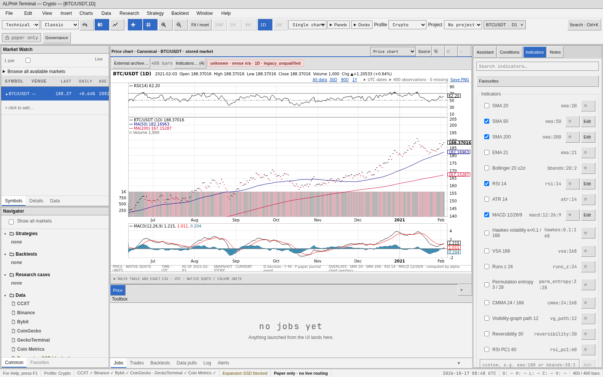
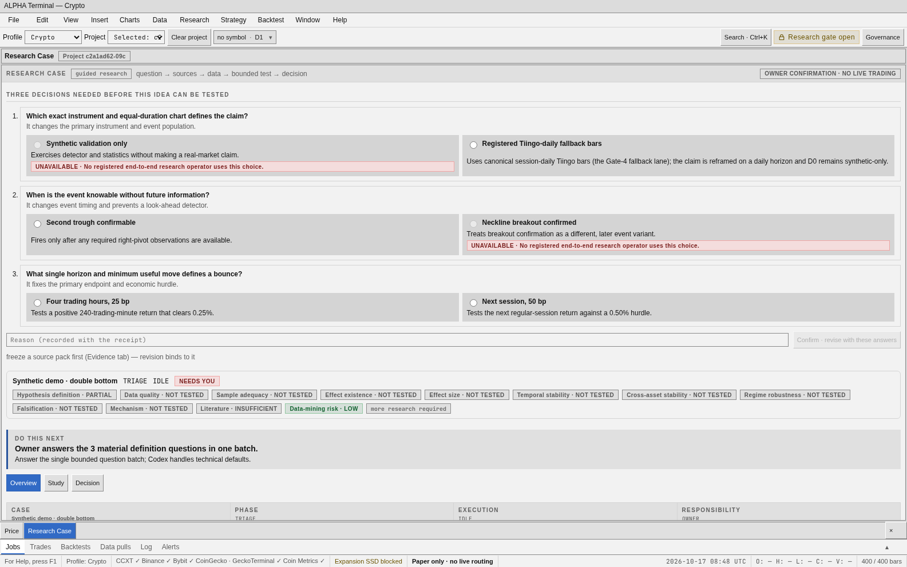
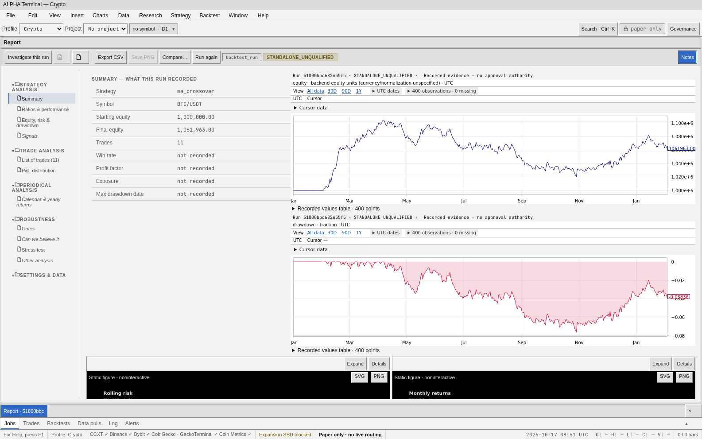
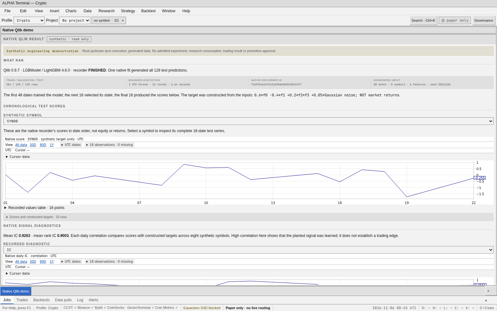
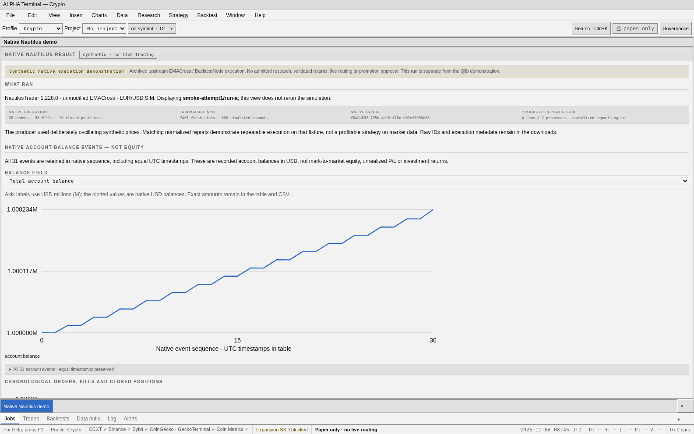
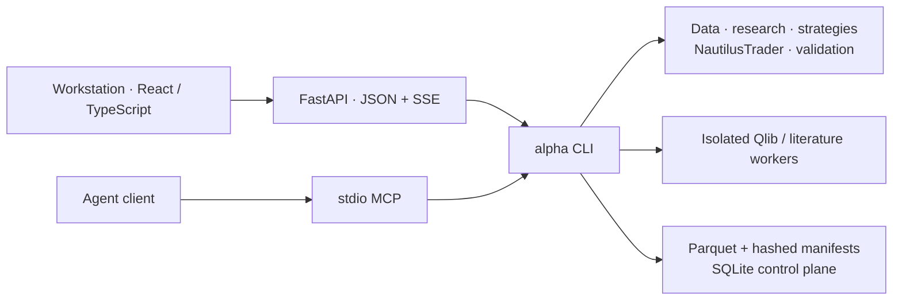

# Project ALPHA

**Status:** [what works today](STATUS.md) · [what the codes mean](docs/reference/glossary.md)

> **Generated-output successor, 2026-11-09 (unqualified):** Two clean local OpenAPI/client/SPA generations are byte-identical. Atlas, installed-worker/runtime acceptance, required exact-tree review and full qualification remain pending. Historical owner/UI results do not qualify this sparse successor. See [build status](docs/BUILD-STATUS.md#2026-11-09--sparse-generated-output-successor-unqualified).

**ALPHA Quant Platform** is a private, local quantitative research workstation for turning a
market idea into a reproducible test and an auditable decision. It brings point-in-time data,
event-driven backtests, statistical validation, model experiments, and research records into one
terminal, backed by the same Python CLI used by agents and automation.

The goal is to assess whether an apparent edge survives costs, out-of-sample testing, and competing
explanations. A chart, a model answer, or a profitable backtest alone does not establish an edge.

The development direction is to reuse pinned Qlib workflows, RD-Agent native loops and
NautilusTrader rather than rebuild their internals. ALPHA retains data provenance, trial
accounting, validation, risk controls and the research UI. The [upstream-first rule](docs/reference/invariants/research-integrity.md#models-and-isolated-workers)
keeps ALPHA's own acceptance; the dated [native reuse crosswalk](docs/archive/2026-11-context-maps/alpha-quant-platform.md#native-upstream-first--2026-11-06)
separates existing integration, supplied synthetic demonstrations and replacements that still
need parity, migration and rollback evidence.



*Chart exploration in the implemented Workstation. These Workstation screenshots were captured from a
fresh build at [fbdcbcf](https://github.com/tradingsystem1880-eng/Project-ALPHA/commit/fbdcbcfdf29aebe3fd43e38bf5ae4051cbf23b98), using the isolated real backend and synthetic test data. They show the
product UI, not live market performance or an owner's account.*

## A plain-English guide

Think of ALPHA as a research notebook with a testing laboratory attached. You bring a market
question; it helps you organize the data, run a repeatable experiment, and inspect the evidence.
It does not decide that an idea is safe to trade. A good-looking chart or a passing software test
is not proof of a profitable strategy.

The parts work together like this:

- **The Workstation is the front desk.** Its charts, Research Cases, and reports help you explore
  questions and inspect recorded results. Start with the [research workflow](#research-workflow)
  and [Quickstart](#quickstart).
- **The CLI is the coordinator.** The browser and agent tools ask it to perform supported actions.
  It connects data, simulations, validation, and research records while keeping explicit owner
  decisions separate from suggestions. See the [CLI workspace](apps/alpha-cli/CONTEXT.md).
- **The research packages are the laboratory.** They keep data tied to what was known at the
  time, simulate strategies with costs, and test competing explanations. Saved snapshots and
  receipts let you check which inputs produced a result. See the [architecture](docs/ARCHITECTURE.md).
- **Workers are separate specialist rooms.** Qlib model experiments and literature tools run in
  their own environments. Their results still need qualification; an installed worker is not
  approval to use a model. See the [Qlib guide](workers/qlib/README.md). Prepare the literature
  worker runtime from its lock with
  `uv sync --project workers/literature --locked --no-dev --no-install-project`; its CLI launcher
  runs the checked-out module with syncing disabled, network access off, and Python safe-path mode.
- **Codex helps explain and investigate.** Its answers are advisory. The file system's search
  (`uv run python scripts/fs.py search "QUERY"`) finds tracked project documents, live ones
  first; neither generated prose nor a search result grants research authority. See
  [Finding anything else](CONTEXT.md#finding-anything-else).
- **The Software Team maintains the machinery.** It changes code, checks the result, and records
  what was delivered. Those engineering checks are separate from approval of market evidence or
  paper operations. See the [engineering rules](docs/reference/invariants/engineering.md#checks-and-commits).

A useful first session is to start the Workstation, capture a Research Case, and inspect what is
missing before running an experiment. An empty installation has no acquired market data or
research results. Follow the [operations runbook](docs/operations/README.md) for deliberate data
setup; do not put credentials in Git or browser state.

Charts, backtests, governed research records, validation tools, and bounded model experiments are
implemented. Full counterfactual ML fold retraining and autonomous RD-Agent research remain
unfinished or deferred. Paper paths require separate opt-ins and readiness evidence; **no
live-capital route ships**. The [scope and limits](#implemented-scope-and-limits) and
[authority matrix](docs/governance/capability-authority-matrix.md) explain these boundaries.

The [first daily rule/control route](docs/work/2026-10-31-packet3-daily-rule/02-plan.md)
connects a frozen momentum rule and control to native execution, accounting, cancellation,
recovery and the existing reports. Artificial fixtures exercise the actual RD-Agent loop under a
hard 1 GiB container limit; they establish no market result. The approved real-data demonstration
still needs qualified retained storage for both its data and authoritative research records.
Its data are discovery only, and modeled next-open prices are not verified live fills.
Portable contract tests separately exercise approval binding, accounting, tamper rejection and
missing-only recovery. Native-process acceptance still requires the installed pinned runtime;
runtime-only skips remain visible in environments that do not provide it.
Independent approved projects can share a data store; this does not grant another launch of the
same study or replenish its allowance.

## Research workflow

The existing literature-review protocol includes a [finance-math evidence guide](docs/operations/finance-math-evidence.md):
source-status checks, 13 carousel book leads, verified access/edition metadata for three public
sources, and an executable synthetic PCA example with original derivations/reference checks.
Full book coverage and governed book anchors remain unverified; no ingestion, market result or
approval follows from the existing-code examples.

1. **Define the question.** Capture an idea as a Research Case; resolve the instrument, event
   timing, outcome, alternative explanations, and falsification criteria before strategy development.
   For literature-informed ideas, anchor claims to verified pages and freeze reported dataset/code
   references with the source pack. Only dataset references can be proposed against a registered
   dataset and D1 analysis family, and the owner must approve that exact contract. Code references
   remain provenance-only until a local code registry exists; they are not acquired or executed.
   Unavailable inputs stay `blocked_data`; a link alone grants no access rights or reproduction claim.
   Owner-selected local PDF imports retain the original bytes under their immutable source identity;
   import and source-screen output report them available only after a hash-verified read, and
   extracted pages stay `UNTRUSTED_SOURCE`. The Literature panel can check and download those
   exact bytes through a project-bound read route; it displays missing, corrupt, and unavailable
   states instead of substituting a different copy.
2. **Fix the data and protocol.** Inspect provider provenance, qualify inputs, and freeze exact
   snapshot membership. Point-in-time reads respect when observations became available; venues,
   quote currencies, native intervals, and dataset families remain explicit.
3. **Explore, then confirm.** The governed lifecycle separates a synthetic D0 pilot, registered
   D1 discovery, and owner-approved one-shot D2 confirmation. Execution depends on a compatible
   registered operator and admitted data; D3 stays unavailable to research. Promotion requires
   verified evidence and an owner decision.
4. **Build and test.** Use rule strategies, the Strategy Builder, scans, and the Development Center.
   Canonical simulations use NautilusTrader, with decisions at close `t` and fills at open `t+1`.
   Standalone sandbox experiments remain unqualified for governed research.
5. **Evaluate and retain evidence.** Inspect recorded trades, equity, drawdown, costs, and validation.
   The gauntlet includes walk-forward testing, randomized nulls, bootstrap intervals, deflated
   Sharpe, and combinatorial cross-validation; parameter searches add overfitting controls.
   Four-family Monte Carlo measures path risk separately from proof of edge.



*Research Case: the real capture workflow exposes unanswered questions and blocked steps before
compute. This demo case has no approved research contract or empirical finding.*

The Workstation also provides linked technical charts and exact data tables/CSV exports, run
comparison, provider and job monitoring, Kronos forecast diagnostics, and an isolated Qlib ML lab.
Its bounded Codex assistant and recorded-run investigations can explain attached evidence and
suggest tests; their output is advisory. Numerical research results come from executed code and
verified artifacts, not generated prose. Codex inference uses the configured remote service.
Settings offers an optional **Backtest result card** (off by default): final drawdown as a
fraction, readable UTC observation time, observation count and artifact provenance for supported v3
backtests. UTC display uses whole seconds; Source retains exact raw Unix seconds. Other run
summaries are unchanged. Missing or invalid backtest evidence shows “Summary unavailable”. Turn it off to restore the
existing summary. It adds no forecast, statistical validation or trading approval.



*Recorded results from an actual synthetic-data backtest. The standalone-unqualified label is
retained; these numbers are a UI demonstration and carry no market-performance claim.*

### Native Qlib and Nautilus Results previews

The Results area now includes two read-only views of **separately executed synthetic native-engine
demonstrations**. Open the Results area at `/#page=results&pane=NativeQlibDemo` and `/#page=results&pane=NativeNautilusDemo`.
These independent previews shipped in PR #118. The captures show saved synthetic artifacts,
not live trading or real market performance; the views never rerun either engine.



*Native Qlib 0.9.7: the executed upstream workflow's predictions, constructed targets, configuration
and exact downloads. Correlation on a synthetic fixture demonstrates the plumbing, not market edge.*



*Native NautilusTrader 1.228.0: an unmodified EMACross/BacktestNode run produced 30 orders,
30 fills and 15 closed positions. The chart preserves all 31 account-balance events, including
identical timestamps. These are account balances, not mark-to-market equity or validated returns.
Chronological reports, configuration, provenance and exact downloads remain available in the view.*

### Joined Qlib → Nautilus synthetic pipeline

A third Results view, `/#page=results&pane=NativeQlibNautilusDemo`, now follows actual upstream
Qlib predictions into ALPHA's existing native Nautilus strategy/harness. The frozen demonstration
retains all 128 predictions, explicitly selects 16 SYN00 scores, models their availability at
session +23 hours, and executes long/flat one-share targets at the next synthetic opening quote.
Its recorded run produced 10 orders, 10 fills and five closed positions. The other two native
views remain separate historical demonstrations.

The view follows actual `qlib.cli.run` → fixed-unit `SignalReplay` → Nautilus `BacktestEngine`.
Its plotted cash observations are not mark-to-market equity; exact equity, commissions, score
links, inputs, configuration and provenance are downloadable. Source/export support hashes are
retained. No screenshot of this view is committed.

Reproduce from this checkout using an existing isolated Qlib environment and a **new** directory:

```bash
uv run python -m alpha_cli.native_qlib_pipeline --qlib-python workers/qlib/.venv/bin/python \
  --output /tmp/alpha-native-pipeline-new --fee-bps 1 --slippage-bps 2
```

The costs are explicit engineering assumptions, not calibrated venue estimates. Prices and the
regression target are independently fabricated; this is not a tested paper hypothesis or evidence
of market edge. The command reads only its bundled synthetic fixture and writes an isolated output
bundle, without adding a canonical run, research history, admission, promotion or live routing.
FitPlan/resource/release decisions and real-data scientific acceptance remain separate.
The [delivery record](docs/BUILD-STATUS.md#2026-11-07--joined-native-qlib-to-nautilus-synthetic-pipeline-candidate)
records this bounded scope. This delivery candidate is not yet merged or deployed.


*Both native Results images above are genuine browser captures from the built ALPHA UI and
isolated empty backend stores. These demonstrations create no admitted research, promotion
approval or live-trading authority.*

See the [file-system routing](CONTEXT.md),
[bounded research workflow](docs/operations/bounded-research-workflow.md),
[research contracts](docs/operations/research-platform-contracts.md), and
[Monte Carlo guide](docs/operations/monte-carlo/README.md) for the detailed protocols.

## Architecture and infrastructure

ALPHA runs on a single local machine. Python 3.12 packages form a locked `uv` workspace with
enforced import boundaries; the CLI is the sole engine and validation composition layer.



| Layer | Responsibility |
| --- | --- |
| Research engine | Point-in-time data access, causal signals, costed simulation, statistical tests, and deterministic artifacts. |
| CLI and control plane | Compose runs; govern projects, contracts, jobs, evidence, and owner decisions. SQLite owns mutable control state. |
| Storage | Immutable snapshots, receipts, manifests, typed Parquet, and HTML audit reports; public crypto bulk data may use a separately configured volume. Paper journals stay outside research run identity. |
| Web and MCP | Relay supported CLI operations and read bounded projections. Neither surface runs the engine in-process. The browser renders recorded Python results. |
| Worker environments | Separately locked processes exchange validated JSON/Parquet. Qlib models and executable objects do not cross into the root environment. |

The production SPA is committed inside the Python web package, so running the installed
Workstation does not require Node. Provider acquisition is explicit; configuration, verification,
data qualification, research admission, and paper readiness are distinct states.

See the [architecture](docs/ARCHITECTURE.md), [decisions](docs/adr/README.md), and
[capability and authority matrix](docs/governance/capability-authority-matrix.md).

## Quickstart

Requires Python 3.12, [`uv`](https://docs.astral.sh/uv/) and, for the web app, Node.js. On a fresh
Linux checkout, one command prepares everything (environments, the built web app, the test
browser, both worker environments) and a second says in plain English what is still missing; both
are safe to repeat ([details](docs/operations/development-loop.md#set-up-a-fresh-machine)):

```bash
bash scripts/setup.sh
python3 scripts/gate.py doctor
```

To do only the Python part, from the repository root:

```bash
uv sync --locked
uv run alpha info
uv run alpha-web
```

Open **http://localhost:8801**. The Workstation binds to loopback for private, single-owner use;
local confirmation is a trusted-local boundary, not multi-user authentication. A new store has
no market data or research results. Use the [data and operations runbook](docs/operations/README.md)
to configure providers and deliberately acquire data; credentials stay outside browser state and Git.

Explore the CLI or capture a question without launching research compute:

```bash
uv run alpha research capture "Does a confirmed double bottom predict a bounce after costs?" --json
uv run alpha research --help
uv run alpha backtest --help
uv run alpha validate --help
uv run alpha info commands --all --json
```

For an MCP-capable client, launch `uv run alpha-mcp` with this repository as its working directory.
The CLI, Workstation, and MCP share the configured data store and authority rules.

<details>
<summary>Linux cloud development setup</summary>

With `uv`, Python 3.12, Node/npm, GNU `timeout`, and Chromium system libraries already available,
run `bash scripts/cloud_setup.sh`. It installs locked root/frontend dependencies and pinned
Chromium, then runs CLI and browser-runtime smokes. It does not replace app E2E tests and the full
gate. With `ALPHA_CLOUD_FOUNDATION=1` it also installs the Git guards, appends the two worker-venv
excludes, uses the verified fontconfig below when the image rule is present, and
reports (never fetches) `origin/main`. Adding `ALPHA_RDAGENT_PRISTINE` and `ALPHA_RDAGENT_SOURCE`
rejects a missing derived-path setting or an unpinned/dirty supplied checkout before installs or
Git-guard changes, then builds the derived root and qualified worker venvs only when absent,
and validates existing ones against their recorded rule profile. Each step fails loud; none claims readiness.
A venv build writes `.alpha/state/runtime/rdagent-venv-<profile>.incomplete` first and renames it to
`.built-<UTC>` only after the new environment validates. If that marker remains, a re-run keeps a venv
that now validates in place and otherwise refuses, preserving the partial venv. Only then, and only for
a marker in exactly the script's own one-line format, `ALPHA_RDAGENT_RETIRE_INTERRUPTED=1` moves the
venv and marker unchanged to `.alpha/state/runtime/interrupted/<profile>-<UTC>/` (kept as evidence, not
runnable because its paths name the original location) and builds afresh. Unmarked environments are
never moved, and nothing is deleted.

For a clean RD-Agent worker setup, explicitly run
`ALPHA_CLOUD_FOUNDATION=1 ALPHA_CLOUD_RDAGENT=1 bash scripts/cloud_setup.sh`.
This mode fetches the fixed public Git commit when no pristine checkout is supplied, creates
the isolated launcher and closed rule/economics environments, validates their identities, and
prints the source export for later shells. Existing source must remain pinned and clean;
failed partial acquisitions are preserved and acquired source is validated before use.
Foundation-only setup stays non-fetching.
See the [clean-bootstrap record](docs/work/archive/2026-10/2026-10-31-clean-rdagent-bootstrap.md)
for fresh-workspace/container evidence and its limits. Provisioning does not grant execution authority.
On a local development checkout, `bash scripts/setup_rdagent.sh` does only the RD-Agent part
(no Git hooks, npm or browser download); see [workers/rdagent/README.md](workers/rdagent/README.md#install-on-a-development-machine)
and the owner's overview [RD-Agent in ALPHA](docs/roadmap/rd-agent-in-alpha.md).

The daily research route additionally uses an explicitly qualified, immutable local Docker image
for its hard physical-memory boundary. Follow the [daily runtime and storage instructions](docs/work/2026-10-31-packet3-daily-rule/02-plan.md#runtime-and-storage-setup).
The older synthetic probes retain their existing process boundary.

Before selecting a different research storage root, inspect the existing authoritative history:
`uv run python scripts/inspect_daily_rule_history.py --data-dir /absolute/existing/data`.
This bounded metadata reader does not initialize or migrate a store; it reports prior daily
deep reservations across all projects, independently of its contract-list page. Unknown or empty
metadata grants no new-root or execution authority. The existing Linux storage backend can use
one explicitly retained mount for control and bulk; it does not make temporary filesystems durable
or replace an existing Mac volume-UUID guarantee. See the [storage/history preflight](workers/rdagent/README.md#storage-and-history-preflight).

Persist these environment-level settings separately so later shells inherit them:

```text
UV_CACHE_DIR=/tmp/project-alpha-uv-cache
UV_TOOL_DIR=/tmp/project-alpha-uv-tools
UV_LINK_MODE=copy
XDG_CONFIG_HOME=/tmp/project-alpha-xdg
npm_config_cache=/tmp/project-alpha-npm-cache
PLAYWRIGHT_BROWSERS_PATH=/tmp/project-alpha-playwright-browsers
SEMGREP_VERSION_CACHE_PATH=/tmp/project-alpha-semgrep/semgrep_version
```

The setup script respects configured paths and creates the Semgrep file's parent directory.
Web ML subprocesses preserve the configured `UV_CACHE_DIR` through the existing isolated-worker
environment, so installed-worker capability checks use the same writable cache as CLI checks.
Web-to-CLI children also receive `MPLCONFIGDIR` verbatim when set for Matplotlib configuration
and cache placement; unset retains existing defaults. Use the
[bounded verification guidance](docs/operations/development-loop.md) for fresh controlled paths
and the limits of this setting.
If temporary assets are not retained, rerun setup synchronously before browser work. Download or
host-library failures require correcting the environment before claiming readiness.

Some cloud images add `/etc/fonts/conf.d/56-prefer-inter.conf` (owned by no package; observed
SHA-256 `1e74ca86…5a9e`), which aliases `-apple-system`, `Segoe UI`, `system-ui` and `sans-serif`
to system Inter. Chromium then renders the chrome stack with that system font, while Linux visual
baselines record the app's self-hosted `Inter Variable` webfont. Run browser checks with a derived
fontconfig that omits only that rule; leave `/etc` and every other rule unchanged:

```sh
if [ -e /etc/fonts/conf.d/56-prefer-inter.conf ]; then
  cfg="$(mktemp -d /tmp/project-alpha-fontconfig.XXXXXX)" && mkdir "$cfg/conf.d"
  for f in /etc/fonts/conf.d/*; do
    [ "${f##*/}" = 56-prefer-inter.conf ] || ln -s "$(readlink -f "$f")" "$cfg/conf.d/${f##*/}"
  done
  sed "s#<include ignore_missing=\"yes\">conf.d</include>#<include ignore_missing=\"yes\">$cfg/conf.d</include>#" \
    /etc/fonts/fonts.conf > "$cfg/fonts.conf"
  export FONTCONFIG_FILE="$cfg/fonts.conf"
fi
```

Verified 2026-10-27 with fontconfig 2.15.0, Playwright 1.61.1 and Chromium 149.0.7827.55: the
derived `fonts.conf` differs from the system file (`93a23ba0…ca22`) only in that include line, and
the 40 linked rules (name plus target SHA-256, sorted) hash to `8e3428b1…22f9`. Without the image
rule, use the system configuration unchanged.

</details>

## Implemented scope and limits

- **Models:** Kronos diagnostics and a separately locked Qlib worker are implemented, including
  fold-local Alpha158-style features, LightGBM, a rank ensemble, and synchronized costed ALPHA
  replay. Full counterfactual fold retraining and single-asset ML equivalence are not implemented;
  the replay is not a full ML gauntlet or promotion evidence. RD-Agent autonomous research is
  deferred. See the [Qlib worker](workers/qlib/README.md) and
  [external capability boundary](docs/adr/0035-generic-study-composition-and-external-capability-adapters.md).
- **Paper operations:** Binance public data feeds a local Nautilus sandbox; stock/ETF intents
  have a separately gated IBKR Paper path. Both are opt-in. Provider/network acceptance, current
  data qualification, and paper readiness require their own receipts. No live-capital route ships.
- **Data:** Tiingo is the canonical stock/ETF EOD path after qualification. Crypto authority is
  family- and venue-specific; comparison feeds never silently substitute. The internal
  [offline funding API](docs/operations/2026-11-05-offline-funding-delivery.md) composes bounded
  injected responses, exact-byte raw retention and validated backward Bybit funding collection.
  Synthetic checks do not establish complete history or live provider access. Production
  acquisition retains its command surface and full-page refusal. QuantPad is excluded from active
  and future data-source plans; historical code, attribution and retained records are preserved.
- **Use and licensing:** Private, local, single-owner use is the approved scope. The repository has
  no declared root project license; dependency licenses do not license ALPHA's original code.
  See the [dependency and license matrix](docs/governance/2026-07-19-dependency-license-matrix.md).

## Software Team: development and verification

Engineering processes are separate from quant research approval and paper authority. Start with
[AGENTS.md](AGENTS.md), [CLAUDE.md](CLAUDE.md), the
[engineering rules](docs/reference/invariants/engineering.md), and the
[development loop](docs/operations/development-loop.md). For UI development, startup fixtures,
and browser checks, use the [frontend guide](apps/alpha-web/frontend/README.md).
The mandatory browser command runs four fixture-specific lanes. The native lane needs explicitly
selected, already-installed native source/runtime assets (`ALPHA_RDAGENT_SOURCE` and
`ALPHA_STOCK_PYTHON`). When neither is set (as in CI) the other three lanes still run and the native
lane is reported as skipped, which is not native qualification; setting only one fails the command.

CI on the pull request is the merge gate: it runs the backend, frontend, literature, Qlib and
eval components, and the owner merges once it is green. Locally, run the fast check:

```bash
uv run python scripts/gate.py check
```

`gate.py component NAME` reproduces one CI job. Passing checks do not establish research
validity or provider readiness. Review this README against the branch in each pull request and
update it where readers need a different explanation.

The existing Qlib recipes now have an [inert W09 planning API](workers/qlib/README.md#inert-w09-planning-contracts)
for metadata identities, source fingerprints and prospective component graphs. It does not
admit or dispatch fits, verify fitted state, or authorize reuse. Private, opt-in
[worker observations](workers/qlib/README.md#w09-invocation-observations) describe calls within
one invocation and can be structurally compared with those identities. Opt-in
[durable diagnostic associations](workers/qlib/README.md#durable-diagnostic-associations)
retain acknowledged checkpoints in the existing job journal, bound to an existing reservation.
Interrupted calls stay unknown; duplicate delivery does not repeat activity. These diagnostics
do not establish durable accounting, verified fitted state or completed research evidence.
Native Qlib parity remains open.

Finding your way: [STATUS.md](STATUS.md) says what works today; the root [CONTEXT.md](CONTEXT.md)
routes each kind of task to the files to read; the [glossary](docs/reference/glossary.md) explains
the codes. The frozen [build record](docs/BUILD-STATUS.md) preserves dated delivery evidence.

The isolated worker also offers an explicit [partial Alpha158 feature-v2 correction](workers/qlib/README.md#opt-in-partial-alpha158-feature-correction):
40 columns use pinned Qlib operators, while 118 retain the legacy recipe. Feature v1 stays the
default. This does not establish native whole-recipe parity or qualify historical models.
Opt-in [feature recipe v3](workers/qlib/README.md#feature-recipe-v3-upstream-alpha158-opt-in)
computes all 158 Alpha158 columns and the fold normalisation with upstream Qlib; a parity test
shows exact equality with Qlib's own Alpha158 handler ([ADR-0042](docs/adr/0042-qlib-worker-delegates-data-layer-to-upstream.md)).
V1 and v2 remain as legacy readers for stored results.
