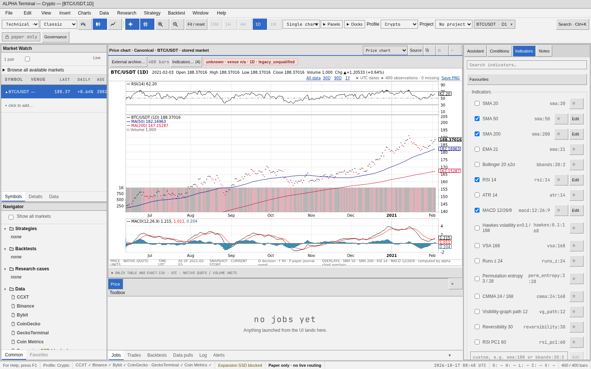
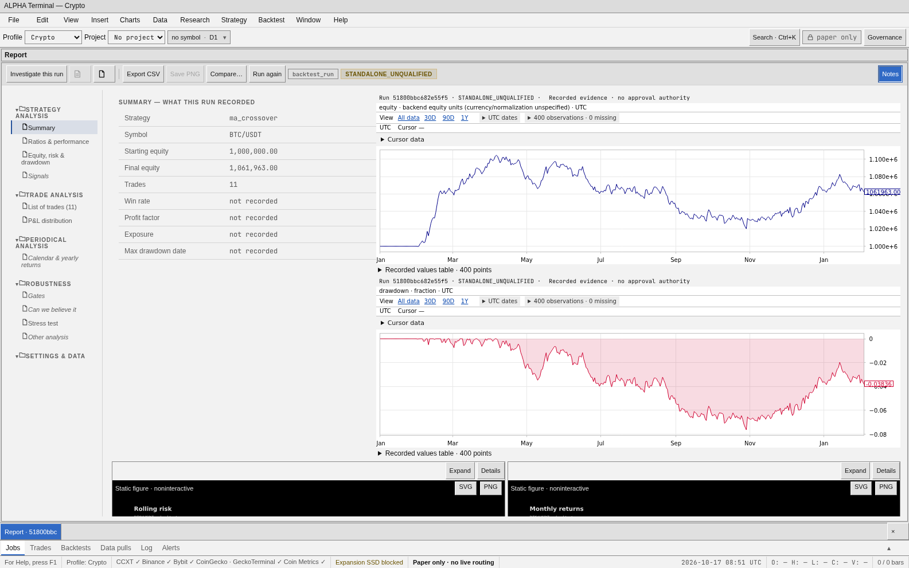
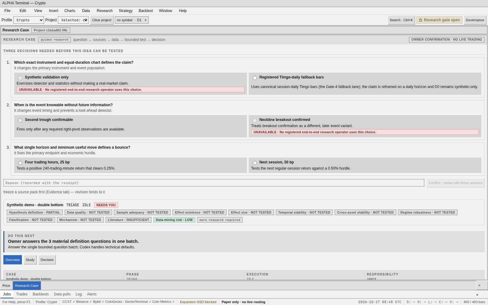

# Project ALPHA

**Status:** what works today: `uv run python scripts/status.py` · [what the codes mean](docs/reference/glossary.md)

ALPHA is a private research workstation for one person, a retail swing trader. It helps you ask
whether a trading idea is real, or just luck in a chart. You give it an idea, it tests the idea on
data with costs included, and it keeps an honest record of everything it tried.

**ALPHA is a research system. It does not promise profits and it has not found an edge.** Every
result it shows is exploratory until it has been confirmed on real data and by you. It trades no
real money: there is no live-trading route and no broker connection.


*The Workstation home screen, shown with made-up demo data.*

## What it does

1. **Keeps data honest.** Prices are stored with where they came from, and every read is
   "as it was known at that date", so a test cannot peek at the future.
2. **Tests a trading rule in one step.** `alpha test` runs a simple rule on several assets, adds
   realistic costs, and records the attempt. A rule decides at the close of one day and trades at the
   open of the next.
3. **Checks its own result.** Every rule test gets an automatic second look (`alpha diagnose`):
   does the opposite trade make money too, how much of the in-sample result survives walk-forward
   testing, and is the profit just a few lucky trades?
4. **Counts every attempt.** One trial ledger records each idea tried, by hand or by an AI loop.
   The deflated Sharpe ratio (a score that is discounted for how many things you tried) counts the
   whole family of related ideas, so trying twenty variants makes a good number harder to earn.
5. **Reads results back.** `alpha results` quotes stored numbers exactly, and checks a written
   answer against the records, so a summary cannot drift from the facts.
6. **Adds outside context.** Macro series (FRED), company filings (SEC EDGAR) and crypto funding
   rates and open interest (Binance, Bybit) can be stored "as first published", so they are usable
   without hindsight.
7. **Runs an AI factor search.** RD-Agent, an open-source research agent, proposes and codes
   market signals ("factors") and ALPHA judges them. See [the RD-Agent loop](#the-rd-agent-factor-loop).
8. **Keeps its own documents from going stale.** Each reference page names the code it describes
   in its front matter `sources:` list. A weekly sweep re-reads those pages against that code and
   fixes drift. See [the document lifecycle](docs/reference/invariants/documentation.md#document-lifecycle).

## What works today

The honest scoreboard is `uv run python scripts/status.py`, made on demand from [`docs/roadmap/capabilities.toml`](docs/roadmap/capabilities.toml).

## How to see it

Install and start the Workstation (needs Python 3.12, [`uv`](https://docs.astral.sh/uv/) and
Node.js):

```bash
bash scripts/setup.sh          # one command; safe to repeat
python3 scripts/gate.py doctor # says in plain English what is still missing
uv run alpha-web               # then open http://localhost:8801
```

The screen binds to your own computer only. A fresh install has no market data and no results,
so it starts empty. The pictures below use **made-up demo bars** (random prices created by a
script), so they show how the screens look, not how any strategy performs.



*Price chart with indicators computed by ALPHA. Demo data.*


*A recorded rule test: what was tested, the audit checks (pass or flag), and a table of "what if
things were slightly different". Demo data. The strong-looking numbers come from made-up prices
that happen to trend; they are not evidence of anything.*


*A diagnostic: the yellow line is the rule's result, the grey bars are results from random paths
with no edge. Demo data.*



*A recorded backtest, with equity and drawdown. Demo data.*


*Data area: a frozen snapshot of stored prices that can be verified later. Demo data.*



*A research case: the idea is written down, and the open questions are listed before any test
runs. Demo case.*


*The RD-Agent panel is read-only and shows what a run recorded. Made-up demo data: these are not real runs.*

## How to run it

All commands run from the repository root. The full list is
`uv run python scripts/commands_reference.py` (made on demand), or ask `uv run alpha --help`.

```bash
uv run alpha info                                   # what is installed and where data lives
uv run alpha test spec.toml --quick                 # test a rule; see research/PLAYBOOK.md
uv run alpha diagnose <run_id>                      # the automatic second look
uv run alpha results                                # list rule tests; `results show <id>` for one
uv run alpha ledger summary                         # every trial recorded so far
uv run alpha research capture "Does X predict Y?"   # write an idea down; runs nothing
```

A rule-test spec is a short file: a list of assets and a rule (`ma_cross`, `breakout` or `tsmom`)
with its settings. [The research playbook](research/PLAYBOOK.md) explains how any idea is tested.
Downloading real data needs the steps and keys in the
[operations runbook](docs/operations/README.md); keep credentials out of Git.

## The RD-Agent factor loop

RD-Agent proposes market factors, writes their code and runs them; ALPHA then judges each factor
instead of trusting RD-Agent's own backtest. The judge:

- handles delisted coins, missing days, and tickers that were re-used or re-denominated, using a
  list of such breaks that you declare;
- ranks factors on a screen, then checks that the top third of coins beat the bottom third;
- tests for look-ahead (a factor that peeks at the future is thrown out) and checks each factor at
  daily, weekly and monthly holding periods, so a result that only appears at one speed is flagged;
- counts every factor in the trial ledger and the deflated Sharpe;
- enforces spending caps on model calls (optional paid embeddings are off unless you turn them on).

Status: **Partial**. About 80 factors were judged by 2026-11-16 and none became a candidate. It
starts with `uv run alpha rdagent run`, and `uv run alpha rdagent status` says where a run is and
what to type next. It is not yet supervised as a background job. Start at [RD-Agent in ALPHA](docs/roadmap/rd-agent-in-alpha.md) and the
[worker guide](workers/rdagent/README.md).

## Where things live

| Folder | What is in it |
| --- | --- |
| `apps/alpha-cli` | the `alpha` command line; the one engine everything else calls |
| `apps/alpha-web` | the Workstation (a local web app) and its API |
| `apps/alpha-mcp` | lets an AI assistant use ALPHA's tools |
| `packages/` | data store, strategies, backtests, statistics, research records |
| `workers/` | separate environments for Qlib, RD-Agent, literature search and textbook methods |
| `research/` | the playbook and the tool cards for testing an idea |
| `docs/` | reference pages, decisions, runbooks and the [roadmap](docs/roadmap/README.md) |
| `scripts/` | the checks and tools: `gate.py`, `fs.py`, generators |
| `tests/` | unit, integration, end-to-end and honesty tests |

Start with [`CONTEXT.md`](CONTEXT.md): it routes any task to the folder that owns it. To find a
document, run `uv run python scripts/fs.py search "words"`; pages are checked by a weekly
sweep. See the [architecture](docs/ARCHITECTURE.md) and the
[purpose of each part](docs/reference/project/overview.md).

## Implemented scope and limits

- Results are **exploratory until confirmed** on real data and approved by you. A good-looking
  backtest is not an edge, and a passing software test is not a profitable strategy.
- Almost everything has only been run on made-up data. Real-data runs are mostly still to be
  confirmed on the owner's own machine.
- **No live-capital route exists.**
- Only the owner can approve a result or a trading step; screens, AI output and passing checks
  confer no approval. See [research integrity](docs/reference/invariants/research-integrity.md).
- Private, local, single-owner use. The repository has no declared project licence; see the
  [dependency and licence matrix](docs/governance/2026-07-19-dependency-license-matrix.md).

## For people changing the code

Rules and the loop for a change are in [AGENTS.md](AGENTS.md) and the
[development loop](docs/operations/development-loop.md). Run the fast check with
`uv run python scripts/gate.py check`; CI on the pull request is the merge gate. Frontend work:
[frontend guide](apps/alpha-web/frontend/README.md). Update this README in a pull request
whenever it would otherwise mislead a reader.
